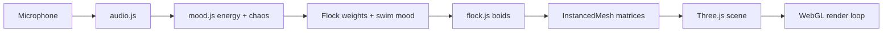

# Fish Swamp

A **watercolour koi pond** in the browser: dozens of koi swim in a shallow pond, and their schooling behaviour reacts to **microphone input**. Stay quiet and they wander in loose groups; hold a steady hum or soft voice and they merge into a tight school; clap or shout and they scatter.

Built as a **learning project** for 3D graphics with [Three.js](https://threejs.org/)—vanilla JavaScript, no React—so scene setup, shaders, and simulation math stay visible in the code. Step-by-step history lives in [`PLAN.md`](PLAN.md) and [`PROGRESS.md`](PROGRESS.md).

**Repository:** [github.com/tk-patel/fish-swamp](https://github.com/tk-patel/fish-swamp)

---

## Quick start

```bash
npm install
npm run dev
```

Open the URL Vite prints (usually **http://localhost:5173**). Use the dev server—do not open `index.html` directly from the filesystem.

On first load, a **microphone overlay** appears. Click **Enable microphone** for sound-reactive behaviour (requires `localhost` or HTTPS). You can skip and still watch the fish with default mood settings.

| Key | Action |
|-----|--------|
| **C** | Toggle debug UI (stats, tuning panels, audio meters) |
| **R** | Recalibrate noise floor (stay quiet for ~1 s) |
| **M** | Toggle manual mood sliders (bypass mic for testing) |
| **1 / 2 / 3** | Manual presets: silence / calm / chaos (only when manual mode is on) |

Optional URL params:

- `?fish=N` — spawn **N** koi (default **22**). Useful for stress-testing the flock sim (e.g. `?fish=300`).

---

## What you see

- **Fixed top-down camera** — the screen is the pond surface; edges are soft boundaries.
- **Painted water floor**, gentle **surface ripples**, **lily pads and lotus**, **disc shadows** under each fish.
- **Koi** with variety-specific colours (shader-driven patterns), flat flowing fins suited to a bird’s-eye view, and a **vertex-shader body wave** for swimming motion.

---

## How it works (high level)



Each frame (`src/main.js`):

1. **Advance time** with delta seconds (movement and animation are frame-rate independent).
2. **Sample audio** (if enabled): loudness, volatility, spectral flux → smoothed **energy** and **chaos**, plus a **calmness** value that builds on steady sound.
3. **Map mood → behaviour** in `mood.js`: blend three anchors (silence, calm, chaos) into boid weights—wander, separation, alignment, cohesion, perception radius, flee—and into swim animation strength.
4. **Update the flock** in `flock.js`: for each fish, sum steering forces (wander, neighbours, tank bounds, optional flee from a jittering threat), clamp speed, integrate position, **slerp** orientation toward velocity. Write instance matrices for the GPU.
5. **Update visuals**: water, lilies, shadows, shader uniforms; render.

Audio and flock logic are **decoupled**: the microphone only updates `moodState`; the flock never touches the Web Audio API.

---

## Mechanics in more detail

### Pond and camera

- Pond **width and depth** are computed from the camera frustum at the water surface (`pond.js`), so resizing the window changes the swimmable area—the screen edges act as banks.
- Fish are kept inside with **soft boundary forces** (stronger near walls, floor, and surface) rather than hard clipping.

### Fish rendering (`fish.js`)

- **Two instanced meshes** per school: opaque **body** (koi patterns in the fragment shader) and transparent **fins** sharing the same `instanceMatrix` so one CPU update moves both.
- **Forward is local +Z** (nose along +Z); the flock uses `lookAt`-style orientation with quaternion **slerp** for smooth turns.
- **Swim wave**: GLSL displaces vertices along X using a sine keyed by body Z, per-fish phase attributes, and mood-driven amplitude/speed.

### Flocking (`flock.js`)

Classic **boids** on the CPU, one fish per slot in typed arrays (`Float32Array` for positions, velocities, orientations):

| Force | Role |
|-------|------|
| **Wander** | Random nudges toward a point ahead—individual motion |
| **Separation** | Steer away from neighbours that are too close |
| **Alignment** | Match neighbours’ heading |
| **Cohesion** | Steer toward the centre of nearby neighbours |
| **Bounds** | Push back from pond walls and depth limits |
| **Flee** | Steer away from a moving threat when chaos is high |

Neighbour search is **O(n²)** (each fish scans all others within perception radius). That is fine for ~20 koi; use `?fish=` to find your machine’s limit (see `PROGRESS.md` performance notes).

### Mood (`mood.js`)

Two inputs, both **0–1**:

- **Energy** — how much sound (after noise-floor calibration).
- **Chaos** — how **spiky** the sound is (loudness volatility + spectral flux).

Three **anchor** behaviours are blended with smoothsteps:

| Anchor | Typical feel |
|--------|----------------|
| **Silence** | Higher wander, moderate cohesion—loose groups |
| **Calm** | Strong alignment + cohesion, large perception—one school |
| **Chaos** | Weak cohesion, strong separation + **flee**—scatter |

Weights are **smoothed** each frame (separate attack/release for calm vs chaos) so schools do not snap instantly.

### Audio (`audio.js`)

- `getUserMedia` with processing helpers **disabled** (echo cancellation, AGC, etc.) so levels stay meaningful.
- **RMS** loudness from the time-domain signal, minus a **1 s noise-floor** calibration, normalized to 0–1.
- **Volatility** — standard deviation of recent loudness (is the level jumping?).
- **Spectral flux** — how much the frequency spectrum changes frame to frame (good for transients like claps).
- **Calmness** rises on sustained steady sound within a loudness band and falls slowly in silence; sudden chaos can **drain** calm quickly.

Tuned constants are documented in `PROGRESS.md` (step 6.10).

---

## Project layout

```
index.html          Entry page, mic overlay, styles
src/main.js         Scene, camera, render loop, wiring
src/fish.js         Koi geometry, instancing, swim shaders
src/flock.js        Boid simulation and instance matrices
src/mood.js         Energy/chaos → flock weights and swim mood
src/audio.js        Microphone and analysis
src/pond.js         Pond size from camera
src/water.js        Painted floor and ripple surface
src/shadows.js      Fish disc shadows on the floor
src/lilies.js       Lily pads and lotus
src/shaders/        Shared GLSL helpers (e.g. noise)
PLAN.md             Original step-by-step build plan
PROGRESS.md         Completed steps and tuning notes
AGENTS.md           Conventions for working on the repo with an AI pair-programmer
```

---

## Scripts

| Command | Purpose |
|---------|---------|
| `npm run dev` | Development server with hot reload |
| `npm run build` | Production bundle to `dist/` |
| `npm run preview` | Serve the production build locally |

---

## Stack

- **Vite** — dev server and bundler  
- **Three.js** — WebGL scene, lights, instancing, custom shaders on `MeshStandardMaterial`  
- **lil-gui** — live tuning (hidden until you press **C**)

---

## Sound behaviour cheat sheet

| You do | Fish tend to |
|--------|----------------|
| Silence (after calm fades) | Wander, loose grouping |
| Steady hum or soft speech | School tightly |
| Clap, shout, sharp taps | Scatter and flee |

For repeatable tests without a mic: press **M**, then **1** / **2** / **3**.

---

## Contributing / extending

This repo was built **one small step per commit** (`step X.Y: …` messages). If you extend it, keep the same separation: audio → mood → flock → render. See `AGENTS.md` for project rules when pairing with an agent.
